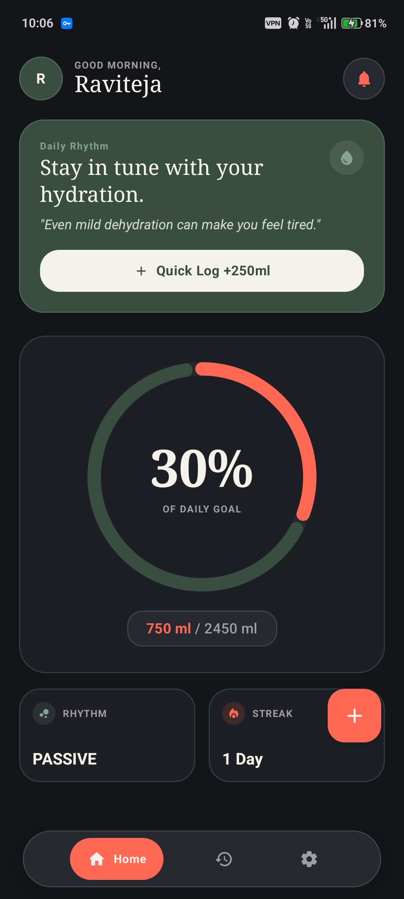
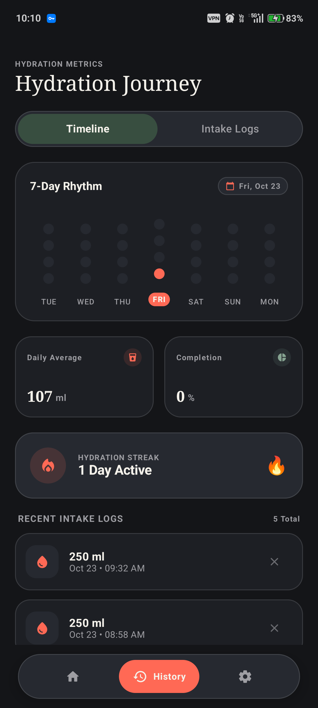
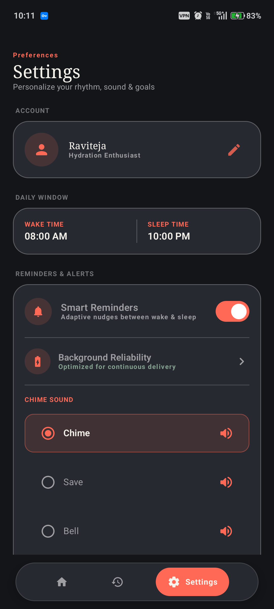
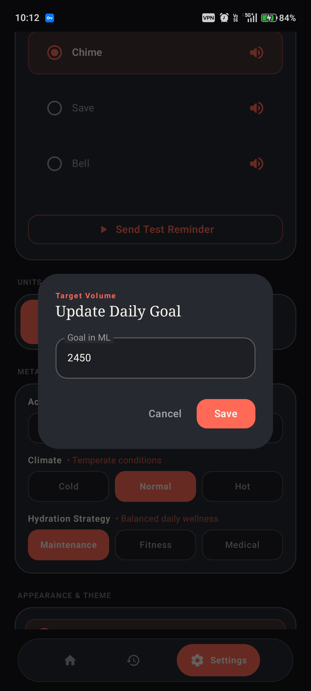

# Hydra — Mindful Hydration Ritual & Vitality Tracker

<p align="center">
  <b>A modern, editorial-style hydration tracking and smart reminder app built with Jetpack Compose & Material 3.</b>
</p>

<p align="center">
  <a href="#-download-apk">
    
  </a>
  
  
  
</p>

---

## 📱 Screenshots Showcase

<p align="center">
  
  &nbsp;&nbsp;
  
  &nbsp;&nbsp;
  
  &nbsp;&nbsp;
  
</p>

<p align="center">
  <i>From left to right: <b>Home Ritual Dashboard</b>, <b>7-Day Dot-Matrix Rhythm & Timeline</b>, <b>Preferences & Smart Reminders</b>, and <b>Target Volume Calibration</b>.</i>
</p>

---

## 📦 Download APK

The compiled debug APK is included directly in the repository for immediate installation and testing:

👉 **[Download Hydra APK (`apk/hydra-app.apk`)](apk/hydra-app.apk)**

To install via ADB on a connected device:
```bash
adb install -r apk/hydra-app.apk
```

---

## ✨ Design Language & Aesthetic

Hydra combines expressive editorial typography with restrained, tactile dark surfaces:

- **Primary Canvas:** Deep Matte Charcoal (`#141518`) & Layered Card Surfaces (`#1D1F24`, `#262930`).
- **Warm Coral Accent (`#FF6955`):** High-contrast terracotta accent used purposefully for progress arcs, active tab capsules, and primary calls to action.
- **Muted Sage Green (`#384E40`):** Editorial secondary surface cards providing visual breathability.
- **Editorial Typography:** High-contrast serif headlines (`FontFamily.Serif`) paired with clean, tabular sans-serif numerals and micro-tracked labels.
- **7-Day Dot-Matrix Rhythm Grid:** Inspired by modern wellness interfaces, displaying daily hydration completion levels with active day indicators.
- **Floating Capsule Dock:** Smooth bottom dock navigation with spring-animated pill indicator.

---

## 🚀 Core Features

- **Personalized Hydration Algorithm:** Dynamically calculates daily fluid intake based on body weight, biological sex, activity level, and climate conditions.
- **Exact & Adaptive Alarms:** Schedules non-intrusive reminders within your active wake window, avoiding sleep interruption.
- **Discrete Metric Tracking:** Real-time progress gauge, day streaks, daily averages, and completion percentages.
- **Dual Unit Support:** Seamless conversion between **Milliliters (ml)** and **Fluid Ounces (oz)**.
- **Tactile Quick Add:** Instant logging via curated category chips (150ml Glass, 250ml Bottle, 500ml Flask, or Custom).
- **Offline & Private:** 100% on-device local persistence using Android Room SQLite and DataStore Preferences. Zero data tracking.
- **Auditory & Haptic Feedback:** Distinctive chime sounds and haptic responses on every log entry.

---

## 🛠️ Tech Stack & Architecture

- **Language:** Kotlin 2.x
- **UI Toolkit:** Jetpack Compose + Material 3 Design System
- **Asynchronous Flow:** Kotlin Coroutines & `StateFlow`
- **Database:** AndroidX Room SQLite (Encapsulated DAOs & Entities)
- **Preferences:** AndroidX DataStore
- **Background Tasks:** Android `AlarmManager` with exact alarm permission handling & WorkManager fallback
- **Audio:** Native `MediaPlayer` sound triggers
- **Confetti Celebration:** Konfetti Compose

---

## 🔨 Build & Run Locally

### Prerequisites
- Android Studio Ladybug / Meerkat (or newer)
- JDK 21 (configured as Gradle JDK)
- Android SDK 35 (Android 15 / 16 support)

### Commands
```bash
# Clone the repository
git clone https://github.com/raviteja-core/Hydra.git
cd Hydra

# Run unit tests
./gradlew test

# Build debug APK
./gradlew assembleDebug

# Install on connected device
adb install -r app/build/outputs/apk/debug/app-debug.apk
```

---

## 📄 License
This project is open source and available under the [MIT License](LICENSE).
